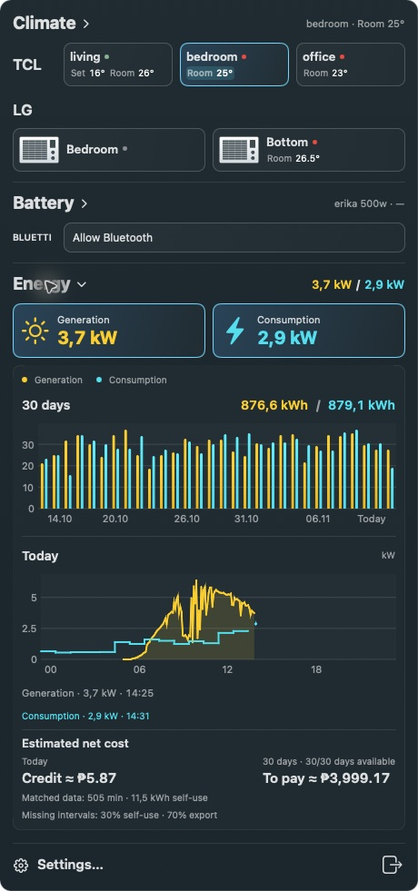

# Super Bar

A native macOS menu bar app for BLUETTI power stations and TCL Home and LG ThinQ air conditioners. Requires macOS 15 or later.

The Mac app, iPhone app and widget use Swift and Apple's system frameworks only.
Building and checking the apps requires Apple's developer tools (full Xcode for
iOS), with no Python, Node, package manager or third-party SDK. The checked-in
iOS Xcode project is edited directly, without a project generator. Python
sources, tests and launchers have been removed from this repository.



## Install

Download the Apple Silicon build from [Releases](https://github.com/sonnenhaft/super-bar/releases/latest), or build from source with Apple Command Line Tools (Apple Silicon or Intel):

```bash
git clone https://github.com/sonnenhaft/super-bar.git
cd super-bar
./start.command
```

`start.command` and `install.command` always build a fresh version, close the previous menu bar apps, and install Super Bar in `~/Applications`. The installer verifies the running app's path, process, version, build number, and executable checksum. If verification fails, it restores the previous installation.

## Use

- The 460-point panel uses a shared dark palette, thin borders and cyan selection accents. TCL, LG and BLUETTI use text labels; device buttons share a brand column and row height, with text aligned at the top. LG units use window-unit artwork and TCL uses wall-unit artwork. Clicking an AC device always opens its controls and chart and activates its menu-bar readout, including repeated clicks. Section headings still collapse their contents while keeping the readout. Powered-off AC readouts show a red power symbol beside the pinned room temperature.
- Only one section expands at a time; collapsing it also hides its charts. TCL and LG share the same brand typography, and Energy has no Deye label. The daily chart tooltip and Energy summary show estimated net cost: the whole-house consumption cost minus revenue from selling all generation. A negative balance is labelled Credit. All generation is valued as sold: previous days default to 70% of the purchase tariff, today to 50%. Days missing either generation or consumption are excluded and coverage is shown. The purchase tariff defaults to ₱13/kWh; the resulting sale prices are ₱9.10/kWh for previous days and ₱6.50/kWh today. These are estimates, not billing measurements.
- Green, red and gray dots mean on, off and offline/unknown. Online devices show room temperature even when off; offline summaries show only the name and dot. TCL summaries use two lines; LG cards pair a device icon with name, temperature pins and available power. Set/Room values are independent pin buttons in summaries and expanded controls. ECO leaves sit beside the set temperature. The expanded card keeps the temperature picker and adds bounded minus/plus controls.
- TCL and battery controls align with their device buttons. The selected chart appears in its own Climate, LG, Battery or Energy section. Settings expand inline from the bottom row; refresh, 9–24 pt text size, login and LG settings remain available. Refresh and text-size sliders share a blue filled track. The panel fits its content and scrolls only when taller than the available screen.
- Refresh settings follow the selected brand. Missing credentials show `Sign in to …`; Bluetooth starts only after **Allow Bluetooth**.
- Energy shows yellow production / blue Tuya consumption without a separate meter row or Deye label. Power tiles open the charts and toggle net power beside the clock; the Energy heading collapses the charts. The chart shows 30 days plus a rolling 24-hour generation/consumption curve, including yesterday's readings. Both headings show estimated net cost after generation credit; the detailed calculation remains below. Rolling totals integrate measured power and meter intervals without filling gaps; `*` marks incomplete coverage. Readings become bold while pinned: production minus consumption, yellow for surplus and blue for deficit. Missing/stale readings produce `—`; the selected consumption meter is never silently replaced.
- Energy compares the net bill with a struck-through bill for the same household consumption without solar. Today, calendar month and 30 days each show sale revenue and ROI for that same period: all generation valued at its applicable sale rate divided by panel cost (default ₱400,000, editable in Settings). Coverage is shown; missing days are not extrapolated, and this is not an annualized return. Existing tariff settings are preserved when adding panel cost.
- Power and energy use integers below 800 W/Wh and one decimal with a comma above it: `735 W`, `1,3 kW`, `28,2 kWh`. Completed Deye days and Tuya schemas are cached instead of refetched every poll.

## Connect devices

**TCL:** Super Bar reuses the local TCL Home session. If sign-in is required, enter your TCL Home email and password in the TCL panel.

**LG:** Settings → Connections → LG ThinQ accepts email, password and account country. The shared native Swift client uses the mobile ThinQ account flow (SPX server-side signing), stores credentials only after login and device discovery succeed, and renews access tokens from the refresh token. Existing PAT accounts continue to work until a mobile login succeeds. Mobile mode currently supports ThinQ2 AC power, temperature, mode and fan controls advertised by the model; ThinQ1 and energy history remain unsupported. Protocol fixtures pass, but live LG login still needs verification.

**BLUETTI:** Press **Allow Bluetooth** on the BLUETTI row to start discovery and grant macOS Bluetooth access. Opening the app or panel never starts Bluetooth. Polling continues in the background after the first connection.

**Deye:** The native Swift client imports an existing protected Deye session once and stores its own session in macOS Keychain. Requests, token renewal and saved-login recovery use URLSession directly. If credentials are missing, use **Sign in to Deye Cloud** in its row. No Python, helper scripts, packages, or external runtime are required; credentials are never bundled.

## Credential storage

Deye, Smart Life, TCL and LG use the shared Keychain backend in standard Mac
builds and all iPhone builds. The explicit local Mac development exception is
described below.
On Mac, credentials live in the login Keychain with synchronization disabled and
normal macOS application access controls. iPhone uses device-only Keychain items
available after first unlock. Access tokens, refresh tokens, session IDs, personal
tokens, passwords and password hashes used for renewal are all treated as credentials; no
new session files are written by either production app. The credential API always
requires a vault; standard builds do not compile the development file backend.
Tests inject an isolated in-memory
vault. Deye, Smart Life and TCL Home retain the entered password inside the same protected
session record after successful login, so their forms can restore it and offer
Show/Hide password. Rejected login attempts never overwrite that record. Unsent
or rejected passwords remain in the form's memory until the app exits; email and
server drafts are ordinary preferences. Short-lived network and Bluetooth session
keys stay in memory only.

Settings → Connections offers **Deye**, **Smart Life**, **TCL Home** and **LG ThinQ** on
Mac and iPhone even when an account is already connected. Background polling never
disables the account picker. LG validates the candidate account and device list before saving credentials;
TCL saves the password with its successful session. The shared form reports
success or a specific authentication/network/storage error without clearing input.
Changing credentials requires successful authentication before saving a new session;
failed authentication keeps the previous account and readings. Existing hash-only
sessions cannot reconstruct a password: enter it once for the new password field.
Desktop fields support the standard Edit commands, including Cmd+A and Cmd+V,
while the nonactivating menu panel owns keyboard focus.

Existing app-owned credential files in Application Support migrate automatically.
The app verifies Keychain write/readback before removing a legacy file. Keychain
errors preserve the old file and never trigger a plaintext fallback. The native
app preserves independently owned import sources. The Deye and Tuya diagnostic
tools also use macOS Keychain: their own legacy session/login files migrate on
first use and are removed only after verified storage. Discovered external
imports remain untouched. The installer and simulator helper do not create
plaintext token copies.

Development builds use ad-hoc signing. A rebuilt Mac app can require macOS
Keychain access approval again because its signing identity changed; the app does
not weaken Keychain access controls to suppress that prompt. A production release
needs stable Apple signing. See [Apple's Keychain access control documentation](https://developer.apple.com/documentation/security/access-control-lists).

### Local Mac development without Keychain prompts

Use one explicit opt-in for local builds and installs:

```bash
SUPER_BAR_DEV_CREDENTIALS=1 ./start.command
```

This compiles the macOS-only development vault. The installed build keeps using
it after relaunch without needing environment variables in Finder. Account
tokens, refresh tokens, passwords and password hashes are saved as private local files in
this checkout's `.build/dev-credentials/` directory (directory
0700, files 0600). The files are `deye-session.json`, `tuya-session.json`,
`tcl-session.json`, `lg-session.json` and legacy `lg-token.txt`. They are plaintext development files,
excluded from Git by `.build/` and kept outside the application bundle.
The bundle contains only a text resource with the directory's absolute path,
so restarting the installed desktop app reuses the same local files. If that
resource is missing or invalid, dev mode refuses credential access. Moving the
checkout requires rebuilding to update the path; no alternate directory or
Keychain fallback is selected.

Writes are bounded, atomic and verified; symlinks and non-private files are
rejected. The same in-memory cache and failed-access suppression still apply.
Existing legacy token/session files can be imported read-only; development mode
never removes those import sources or exports anything from Keychain. If only a
Keychain account remains, connect it once in the development app. A Keychain
error never activates this mode automatically.

`SuperBarDevCredentials = true` in the built app's `Info.plist` identifies this
mode. `publish.command` rejects its marker or an enabled development flag.
Release builds reject the flag before compilation. To return to a production
Keychain build, run:

```bash
SUPER_BAR_DEV_CREDENTIALS=0 SUPER_BAR_RELEASE=1 ./build.command
```

No development file vault is compiled into iOS, regardless of this environment
variable.

## Build and check

```bash
./build.command
Tests/check.command
```

The optimized, ad-hoc signed app is written to `dist/Super Bar.app`. Build and installation scripts report progress while running.

## Native Tuya

Super Bar reads Smart Life directly with Foundation, CryptoKit and Security. On first launch it imports the existing protected `.env.tuya-session.json`, including the chosen main meter, and saves its own session in macOS Keychain. No script, Python interpreter, package or SDK is bundled or invoked. Session renewal uses the saved login; sign-in is Smart Life / country 63 / EU. Only authentication, device reads, and daily/hourly statistics actions are allowed. Device commands are rejected before a request can leave the client.

The Deye charts compare yellow generation with blue Tuya consumption: paired
30-day energy bars and a connected step line for today's completed-hour average
power, labeled Generation and Consumption. Hourly statistics are already scaled kWh; a full hour's kWh × 1000 gives
average W. Missing hours and unfinished-hour aggregates are omitted. The current
hour is extended using live Tuya samples already collected for the readout.
Adjacent hourly intervals connect at their shared boundary. Consumption lines
break only for missing coverage longer than 30 minutes; other power lines break
after 10 minutes. Date labels are thinned out, and hovering shows the exact day.
History uses the selected
main meter, checks its timezone against the Manila station calendar, and is
cached between launches. It refreshes at most every five minutes while the Deye
charts are selected, reusing completed days. A `*` on a 30-day total indicates
missing days. The 15-minute API remains a diagnostic probe until verified for
this meter. Today's chart time labels use Manila time, including the Deye curve.

Live status polling and chart history have independent schedules. Deye and Tuya
update today's history at most every five minutes while their charts are selected;
their APIs return a whole day, so completed hours are not separately requested.
Completed days are cached and the previous day's partial total is finalized after
midnight. TCL's summary API is polled every 15 minutes (hourly data once an hour),
with one-minute sampling near its 09:00 accounting boundary. LG fetches missing
completed dates, then keeps that archive until another day is complete; failed or
missing archive data is retried at most hourly. Fast live samples for LG, TCL and
BLUETTI still extend local power curves without additional history API requests.

## Credits

Super Bar combines the original TCL Bar, BLUETTI Bar, and LG Bar projects. The LG module is based on LG Bar 1.4.1, commit `cc3d4ac701c48a8dfae677f3f2ba72961e268715`. BLUETTI third-party notices are included in `Resources/THIRD_PARTY_NOTICES.txt`.

TCL Eco applies 26° and Silent together. Section headers toggle across their full width; compact TCL cards show set temperature beside the name and room temperature below.

### Keychain migration verification (2026-11-13)

Startup, polling and token renewal use non-interactive Keychain queries: when
authorization is required they fail immediately instead of showing a system dialog.
The panel offers **Дать доступ к Keychain**; only that explicit action permits
interactive credential reads, on a background worker. Saved readings and other
panel controls remain available while the user decides or after cancellation.

Credential access is shared across the app process. Successful and missing reads
are cached in memory; concurrent callers do not each reopen Keychain. A failed
access attempt stops further uncached reads/writes until the user selects
**Дать доступ к Keychain**, explicitly reconnects an account, or
restarts the app. Already loaded accounts remain usable. Saving a changed value
still writes to Keychain and verifies it by reading the underlying Keychain item
before updating the cache or removing an app-owned legacy file. No credential
cache is written to disk. External Keychain edits are read on the next app launch.

For Mac builds, set `SUPER_BAR_SIGNING_IDENTITY` to the same valid code-signing
certificate identity on every build (the installer inherits it). Without this
setting, local builds remain ad-hoc signed: their identity changes with the
binary, so macOS may request access again after an update. Existing Keychain
items have separate access controls; this change does not promise a single
initial authorization dialog for all accounts or loosen those controls.

The earlier migration build on Mac was installed and launched twice. Deye, Tuya, TCL and LG
continued reading their accounts after the app-owned legacy credential files were
removed; those files stayed absent after relaunch. Installation was verified
against the built executable checksum. Synthetic tests exercise both JSON session
and LG UTF-8 token migration, failed reads/writes/readback, corrupt data and
preservation of independent import sources. After removing the file backend,
the native test suite and iOS project checks passed again; the updated iPhone
app launched with existing connections. The new optimized Mac bundle built and
passed signature verification, but its runtime check is blocked by the local
launch environment. No hardware control commands were sent.

## Swagger / OpenAPI JSON

The native clients' HTTP requests are documented in one self-contained
[OpenAPI 3.0.3 JSON](docs/api/openapi.json), covering Deye, LG ThinQ, TCL and Tuya.
Import this file into a compatible Swagger/OpenAPI viewer. Operations are grouped
by provider and retain their own server origins and authentication schemes.

These are code-derived subsets, not complete vendor contracts or distribution
permissions. They contain no credentials or embedded signing keys. Tuya's seven
RPC actions share its real `POST /api.json` endpoint; action-specific payloads and
results are described in `x-rpc-actions` and component schemas. Dynamic TCL hosts
must come from discovery. Tuya signatures, TCL SaaS signatures and AWS SigV4
require an authorized signing-aware client; Swagger UI alone does not generate
these signatures. BLUETTI uses BLE and is not represented as a fictional HTTP API.
