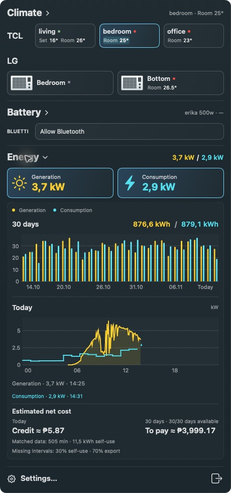

# Super Bar 1.2.26

Native macOS controls for TCL and LG air conditioners, BLUETTI batteries, and Deye generation with Tuya whole-house consumption.

- Reworked dark sections with consistent device cards, text brand labels, window-unit artwork for LG and wall-unit artwork for TCL. One section expands at a time; collapsing it also hides its charts.
- Preserved temperature and room-temperature pinning, ECO, fan and airflow controls, presets, and the menu-bar readout. Powered-off air conditioners show a red power symbol beside the pinned room temperature.
- Added native Deye and Tuya clients, paired 30-day energy bars, today's power curves, cached history and 15-second live power polling.
- Daily tooltips and the Energy summary show estimated grid purchases minus export revenue. Self-used generation is already deducted; negative balances show Credit. Missing daily readings remain unavailable. Tariffs and fallback self-use assumptions are configurable.
- Bluetooth access starts only after Allow Bluetooth. The app uses Swift and Apple frameworks only; standalone diagnostic scripts are not bundled or required.

Download **Super-Bar-1.2.26-arm64.zip**, extract **Super Bar.app**, and move it to Applications. Requires macOS 15 or later on Apple Silicon. Intel Macs can build from source with Apple Command Line Tools. The build is ad-hoc signed, not notarized.

The archive contains no credentials, saved readings, or local session-file paths. Energy amounts are estimates based on matching intervals or the configured scenario; they exclude fixed charges and other utility-bill adjustments.

Validation: native Swift checks, standalone diagnostic checks, signature verification, and manual section-collapse / net-cost verification.
